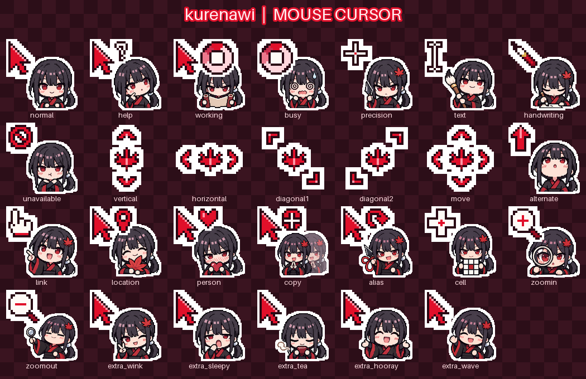

# kurenawi cursors

紅（くれない）のピクセルアート・マウスカーソルセット。左上の紅いピクセル記号がクリック位置で、右下にちびくれないが付きます。Windows / macOS / Web（CSS）で使えます。

A pixel-art mouse cursor set featuring kurenawi. Windows (`.cur` / `.ani` + `install.inf`), macOS (Mousecape `.cape`) and PNGs for CSS.

- **デモ（全パターンを試せる）**: https://kurenawi.github.io/kurenawi-cursors/
- **ダウンロード**: [Releases](https://github.com/kurenawi/kurenawi-cursors/releases/latest) の `kurenawi-cursors-<version>.zip`



## 収録カーソル

- **Windows の標準17種**: 通常、ヘルプ、バックグラウンド作業中（アニメ）、待ち（アニメ）、精密選択、テキスト選択、手書き、利用不可、上下・左右・斜め2方向のリサイズ、移動、代替選択、リンク、位置選択、人の選択
- **macOS で使うもの**: 上の該当分に加えて、コピー、エイリアス、セル選択、ズームイン、ズームアウト
- **おまけ**: ウインク、ねむい、お茶、バンザイ、バイバイ（自分で割り当てて使う）

各カーソルは 32 / 64 / 96 / 128 px を収録しているので、高解像度ディスプレイや拡大表示でも崩れにくいです。

## インストール

まず [Releases](https://github.com/kurenawi/kurenawi-cursors/releases/latest) から zip を落として展開してください。

### Windows 10 / 11

1. `windows/install.inf` を右クリック →「インストール」
   （Windows 11 では「その他のオプションを確認」の中にあります）
2. 設定 → Bluetooth とデバイス → マウス →「マウスの追加設定」→「ポインター」タブ
3. 「デザイン」で **kurenawi** を選んで「OK」

おまけやmacOS向けのカーソル（`extra_*.cur`、`copy.cur` など）は、ポインター一覧で好きな行を選んで「参照」から個別に設定できます。

元に戻すときは、同じ画面で「デザイン」を「Windows 標準」に戻します。

### macOS（Mousecape を使用）

macOS には標準でカーソルを着せ替える機能がないため、無料アプリ [Mousecape](https://github.com/alexzielenski/Mousecape) を使います。

1. **Mousecape を入れる**
   - macOS 26 (Tahoe) 以降: 公式版 (1813) は未対応なので、Tahoe 対応版 [Mousecape-TahoeSupport](https://github.com/AdamWawrzynkowskiGF/Mousecape-TahoeSupport/releases) を使います。
   - macOS 15 以前: 公式版 [Mousecape 1813](https://github.com/alexzielenski/Mousecape/releases) で動きます。
   - `Mousecape.app` を「アプリケーション」フォルダに入れます。
   - 未署名アプリのため開けない場合は、ターミナルで次を実行してから開きます（起動時のセキュリティ確認を外す操作です。自己判断でどうぞ）。
     ```sh
     sudo xattr -dr com.apple.quarantine /Applications/Mousecape.app
     ```
2. **cape を読み込む**: `macos/kurenawi.cape` をダブルクリック（または Mousecape のウインドウへドラッグ）
3. **適用する**: 一覧の「kurenawi」をダブルクリック、または右クリック →「Apply」
4. **再起動後も残す**: メニューバーの Mousecape →「Install Helper Tool」
   - うまくいかない場合は `Mousecape.app` を右クリック →「パッケージの内容を表示」→ `Contents/Library/LoginItems/com.alexzielenski.mousecloakhelper.app` を、システム設定 → 一般 → ログイン項目と機能拡張 →「ログイン時に開く」に追加します。

元に戻すときは Mousecape で「Reset」、またはターミナルで:

```sh
/Applications/Mousecape.app/Contents/MacOS/mousecloak --reset
```

補足:
- cape には macOS 26 で必要な `ArrowS` / `IBeamS`（矢印とテキストカーソルの新しい名前）も入っています。矢印だけ元のままになる場合は、一度 Reset してから適用し直してください。
- 大きさは システム設定 → アクセシビリティ → ディスプレイ →「ポインタのサイズ」で変えられます。
- ブラウザ上で他のページへドラッグして「受け付けない」場所に来たとき、macOS は禁止マークを出しません（通常の矢印のまま）。これは OS / ブラウザ側の仕様です。

### Web（CSS）

`png/` の画像を `cursor: url()` で使えます。クリック位置（ホットスポット）は 32px 版の座標で `hotspots.tsv` にあります。

```css
.kurenawi {
  cursor: url(png/normal@32.png) 1 1, auto;
  cursor: -webkit-image-set(url(png/normal@32.png) 1x, url(png/normal@64.png) 2x) 1 1, auto;
}
.kurenawi a { cursor: url(png/link@32.png) 3 1, pointer; }
```

## 動作確認

[デモページ](https://kurenawi.github.io/kurenawi-cursors/) のマスにマウスを乗せると、その種類の OS カーソルに切り替わります。インストール後に開けば、くれない版に置き換わっているかを全種類まとめて確かめられます。

## ソースからビルド

```sh
pip install pillow numpy
python3 build_cursors.py      # dist/kurenawi-cursors/ に .cur/.ani/.inf/.cape/PNG を出力
python3 make_test_page.py     # デモページ（index.html）を出力
python3 -m unittest discover -s tests
```

- `art/sheet_a.png`（16表情）と `art/sheet2_a.png`（macOS向け5種＋バイバイ）がキャラの元絵です。プロンプトは同じフォルダの `cursor_sheet*.txt`。
- `main` への push で GitHub Pages のデモが自動デプロイされ、`v*` タグの push で Release の zip が作られます。

## クレジットとライセンス

- キャラクター: kurenawi（オリジナルキャラクター）。ちびキャラの絵は画像生成AI（OpenAI の画像生成）で描いたものを加工しています。矢印などのピクセル記号は手打ちです。
- 構成のアイデア: 左上に記号・右下にキャラを置くレイアウトは、[@crazyghsot さんの「[F2U] Mouse Cursors | Momonga」](https://x.com/crazyghsot/status/2119293841035698375) を参考にしました。Momonga の絵は一切使っていません。
- ライセンス:
  - コード（`*.py`、`tests/`、ワークフロー）: [MIT](LICENSE)
  - カーソル画像と元絵（`art/`、配布物の画像）: [CC BY-NC 4.0](LICENSE-ART.md)。個人利用や非営利の配布・改変は、クレジットを付ければ自由です。商用利用は不可です。
